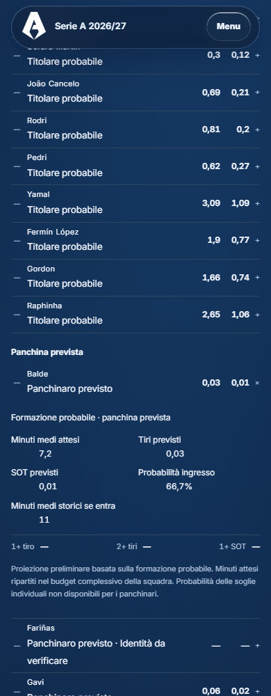

# Champions MD3 — convocati, panchina prevista e proiezioni preliminari

## Risultato

La modalità `probable` ora accetta l’undici probabile già importato e la panchina prevista ricavata dai convocati documentati della partita. La panchina ufficiale non è più richiesta per questa modalità. Il controllo `official` continua a richiedere undici e panchina ufficiali; il gate condiviso delle altre elaborazioni e il motore Serie A non sono stati modificati.

**34 giocatori con tiri e SOT operativi preliminari: 20 titolari probabili e 14 panchinari previsti, tutti di Barcellona e Atlético.** Sono 434 i giocatori classificati: 396 probabili titolari e 38 panchinari previsti. I restanti **400 hanno tiri/SOT N/D**. Minuti supportati per 349 giocatori complessivi; presenza di minuti non significa automaticamente disponibilità di una proiezione di tiro.

Quattro squadre rimangono escluse: Sabah, Slavia Praha, Slovan Bratislava e Shakhtar Donetsk. Tutte le loro statistiche storiche sono conservate.

## Convocati acquisiti

Trovati tre elenchi completi specifici per la partita, datati 19 ottobre 2026:

- Borussia Dortmund, 24 convocati / 13 panchinari previsti: https://www.bvb.de/de/de/aktuelles/news/news.html/2026/10/19/Das-ist-der-BVB-Kader-fuer-das-Spiel-gegen-Sabah.html
- Barcellona, 23 convocati / 12 panchinari previsti: https://www.fcbarcelona.com/en/football/first-team/news/4594106/fc-barcelona-squad-for-the-trip-to-psg
- Atlético de Madrid, 24 convocati / 13 panchinari previsti: https://www.atleticodemadrid.com/convocatorias/los-citados-para-el-stuttgart-atleti

Ricerca mirata effettuata per tutte le 36 squadre, documentata in callup-research.json. Per le altre 33 non è stato reperito nella ricerca un elenco completo verificabile della partita. Questo non afferma che nessun elenco esista altrove. Non sono stati riutilizzati convocati di altre giornate, rose stagionali, registrazioni UEFA, liste giovanili, notizie sui biglietti o semplici informazioni d’allenamento.

Il file sorgente separato conserva fixture ID, club, URL, consultazione, pubblicazione, hash e archivio HTML. Ogni convocato ha ruolo atteso starter/bench, identità canonica quando verificata, provenienza, certezza della convocazione documentata e certezza del ruolo probabile. La sottrazione dell’XI usa ID o alias espliciti revisionati: Gadou/Joane Gadou, Veerman/Joey Veerman e Nwaneri/Ethan Nwaneri sono sottratti dall’XI anche se l’ID locale rimane irrisolto. Nessun nuovo giocatore o trasferimento statistico automatico.

Indisponibili e squalificati sono esclusi; i dubbi rimangono separati, senza probabilità di disponibilità inventate. Le identità non risolte sono 24 nel complesso: 15 titolari già presenti e 9 panchinari, tutti N/D.

## Modalità e controlli

Un adattatore solo MD3 (`scripts/champions/md3-lineup-policy.js`) gestisce:

- official: documentazione ufficiale sia dell’XI sia della panchina;
- probable: XI probabile documentato e lista completa dei convocati della specifica fixture, da cui deriva la panchina prevista;
- convocati mancanti: bench:null e blocco esplicito; nessun fallback alla rosa.

Dopo la verifica della modalità si applicano gli stessi controlli di identità, disponibilità, baseline, minuti, esclusioni, budget e riconciliazione del motore Champions. Non sono stati modificati i moduli current-season-offline.js, substitute-minutes.js o player-volume-utils.js, né coefficienti o prior.

## Minuti, volumi e probabilità

Riutilizzato estimateExpectedMinutes: per i titolari almeno 3 presenze e massimo 8 recenti; per i panchinari almeno 3 panchine nominate e 2 ingressi, massimo 12 panchine. La probabilità d’ingresso deriva dalla frequenza storica e i minuti medi attesi dal prodotto di tale frequenza per i minuti medi se entra. Nessun minuto attribuito automaticamente al solo convocato. Le evidenze e i cutoff sono nei metadati interni.

Riutilizzata anche la politica di budget 990 minuti già presente nell’estensione Champions substitute-minutes.js. I minuti storici grezzi restano separati dai minuti corretti per il budget: Barcellona passa da 1003.3 a 990 minuti, con fattore deterministico 990/1003.3; Atlético mantiene 979.6. Non si tratta di un nuovo coefficiente libero. I minuti medi storici se entra rimangono identificati come storici nell’interfaccia.

I tiri/SOT derivano dai rate ammessi del candidato congelato, moltiplicati per l’esposizione prevista e riconciliati con il helper esistente, mantenendo i limiti 0.72–1.35 e la tolleranza 0.02. I per90 diagnostici non sono stati pubblicati direttamente come previsioni. I canali basati sui minuti stimati/non certificati del Pacchetto 1 non sono stati attivati nel primario.

Le 34 proiezioni prodotte riconciliano con i volumi di squadra entro 0.02; nessun SOT individuale supera i tiri. Dove il modello non può superare i controlli, non si forza una rinormalizzazione. Dortmund ha i convocati ma mantiene N/D per il gate dei volumi della fixture Sabah–Dortmund, già congelati N/D. Gli otto scostamenti del precedente sottoinsieme diagnostico non vengono trasformati in previsioni: riguardano club per i quali non sono stati acquisiti convocati sufficienti a completare il modello.

Per 20 titolari sono disponibili le tre soglie già supportate dal Poisson Champions: 1+ tiro, 2+ tiri, 1+ SOT. La funzione è numericamente confrontata con quella originale del builder Champions. Sono probabilità preliminari condizionate alla partenza da titolare, senza nuove quote o selezioni. Per i panchinari restano N/D le probabilità delle soglie: il percorso validato dei minuti non definisce una distribuzione per combinarle con l’eventuale mancato ingresso, e non ne è stata inventata una.

## Giocatori operativi

| Squadra | Giocatore | Ruolo previsto | Minuti attesi | Tiri | SOT |
|---|---|---|---:|---:|---:|
| Barcelona | Espart | starter | 87.6 | 0.49 | 0.12 |
| Barcelona | Cubarsí | starter | 88.8 | 0.31 | 0.08 |
| Barcelona | Gerard Martín | starter | 84.4 | 0.3 | 0.12 |
| Barcelona | João Cancelo | starter | 81.7 | 0.69 | 0.21 |
| Barcelona | Rodri | starter | 74 | 0.81 | 0.2 |
| Barcelona | Pedri | starter | 74.6 | 0.62 | 0.27 |
| Barcelona | Yamal | starter | 87.4 | 3.09 | 1.09 |
| Barcelona | Fermín López | starter | 71.1 | 1.9 | 0.77 |
| Barcelona | Gordon | starter | 73.9 | 1.66 | 0.74 |
| Barcelona | Raphinha | starter | 84.9 | 2.65 | 1.06 |
| Barcelona | Balde | bench | 7.2 | 0.03 | 0.01 |
| Barcelona | Gavi | bench | 8.7 | 0.06 | 0.02 |
| Barcelona | G. Jesus | bench | 8.9 | 0.25 | 0.13 |
| Barcelona | Adeyemi | bench | 16.8 | 0.35 | 0.15 |
| Barcelona | Olmo | bench | 20 | 0.51 | 0.16 |
| Barcelona | De Jong | bench | 21 | 0.12 | 0.03 |
| Barcelona | Bernal | bench | 9.7 | 0.09 | 0.03 |
| Atlético de Madrid | Llorente | starter | 87.4 | 0.75 | 0.28 |
| Atlético de Madrid | Marc Pubill | starter | 90 | 0.52 | 0.19 |
| Atlético de Madrid | Hancko | starter | 82.6 | 0.54 | 0.15 |
| Atlético de Madrid | Grimaldo | starter | 89.9 | 1.39 | 0.51 |
| Atlético de Madrid | Simeone | starter | 74.8 | 1.2 | 0.41 |
| Atlético de Madrid | Barrios | starter | 82.4 | 0.91 | 0.26 |
| Atlético de Madrid | Cardoso | starter | 82 | 0.56 | 0.15 |
| Atlético de Madrid | Álex Baena | starter | 64.3 | 0.93 | 0.23 |
| Atlético de Madrid | Alvarez | starter | 78.5 | 1.93 | 0.92 |
| Atlético de Madrid | Lookman | starter | 64.8 | 1.66 | 0.53 |
| Atlético de Madrid | LE NORMAND | bench | 15.3 | 0.06 | 0.02 |
| Atlético de Madrid | OBED VARGAS | bench | 3.3 | 0.03 | 0.01 |
| Atlético de Madrid | MENDOZA | bench | 2.3 | 0.03 | 0.01 |
| Atlético de Madrid | KANG IN | bench | 15.9 | 0.28 | 0.11 |
| Atlético de Madrid | HJULMAND | bench | 8 | 0.08 | 0.02 |
| Atlético de Madrid | SØRLOTH | bench | 22.8 | 0.63 | 0.32 |
| Atlético de Madrid | J. DAVID | bench | 10 | 0.2 | 0.08 |

Il dettaglio di probabilità, ingressi, campioni, ID e blocchi dei 434 giocatori è in player-projections.csv e nel JSON normalizzato.

## Copertura delle 36 squadre

| Squadra | Convocati documentati | Panchina prevista | Titolari operativi | Panchinari operativi |
|---|---|---:|---:|---:|
| Fenerbahçe | Non reperiti | N/D | 0 | 0 |
| Slavia Praha | Non reperiti | N/D | 0 | 0 |
| Sabah | Non reperiti | N/D | 0 | 0 |
| Borussia Dortmund | Sì | 13 | 0 | 0 |
| Roma | Non reperiti | N/D | 0 | 0 |
| Slovan Bratislava | Non reperiti | N/D | 0 | 0 |
| Porto | Non reperiti | N/D | 0 | 0 |
| PSV Eindhoven | Non reperiti | N/D | 0 | 0 |
| Liverpool | Non reperiti | N/D | 0 | 0 |
| Villarreal | Non reperiti | N/D | 0 | 0 |
| Manchester City | Non reperiti | N/D | 0 | 0 |
| AEK Athens | Non reperiti | N/D | 0 | 0 |
| Paris Saint-Germain | Non reperiti | N/D | 0 | 0 |
| Barcelona | Sì | 12 | 10 | 7 |
| Napoli | Non reperiti | N/D | 0 | 0 |
| Bodø/Glimt | Non reperiti | N/D | 0 | 0 |
| Stuttgart | Non reperiti | N/D | 0 | 0 |
| Atlético de Madrid | Sì | 13 | 10 | 7 |
| Como | Non reperiti | N/D | 0 | 0 |
| Manchester United | Non reperiti | N/D | 0 | 0 |
| Lille | Non reperiti | N/D | 0 | 0 |
| Galatasaray | Non reperiti | N/D | 0 | 0 |
| Aston Villa | Non reperiti | N/D | 0 | 0 |
| Viking | Non reperiti | N/D | 0 | 0 |
| Club Brugge | Non reperiti | N/D | 0 | 0 |
| Lens | Non reperiti | N/D | 0 | 0 |
| Bayern München | Non reperiti | N/D | 0 | 0 |
| Arsenal | Non reperiti | N/D | 0 | 0 |
| Inter | Non reperiti | N/D | 0 | 0 |
| Shakhtar Donetsk | Non reperiti | N/D | 0 | 0 |
| Real Madrid | Non reperiti | N/D | 0 | 0 |
| Leipzig | Non reperiti | N/D | 0 | 0 |
| Real Betis | Non reperiti | N/D | 0 | 0 |
| Feyenoord | Non reperiti | N/D | 0 | 0 |
| Sporting CP | Non reperiti | N/D | 0 | 0 |
| LASK | Non reperiti | N/D | 0 | 0 |

## Motivi dei 400 N/D

Assegnazione per motivo prioritario, non duplicata: un giocatore può avere ulteriori blocchi nel JSON/CSV.

| Motivo prioritario | Giocatori |
|---|---:|
| Quattro squadre escluse | 44 |
| Disponibilità in dubbio | 6 |
| Identità non risolta | 24 |
| Portiere: tiri/SOT non modellati | 34 |
| Minuti storici insufficienti | 6 |
| Baseline/ruolo non utilizzabili | 12 |
| Volumi di squadra N/D | 15 |
| Convocati partita non documentati | 259 |

## Interfaccia

Aggiornate le 18 Letture nella sola diramazione MD3, distinguendo titolare probabile e panchinaro previsto. Conservati i componenti, colori e stile esistenti. Aggiustamento responsive limitato a #lettura-probabili: su smartphone le due squadre sono impilate e le colonne numeriche hanno spazio sufficiente per i decimali, eliminando sovrapposizioni. Nessuna foto, nessun nuovo componente, nessun testo di fonte nell’interfaccia.

## CL3

Prima di qualsiasi modifica il browser Edge locale ha mostrato già CL3 nell’archivio http://127.0.0.1:8766/schedina.html, accanto a CL1/CL2 a 1440 px (249×300), con sette esiti e stato Da giocare; presente anche a 390 e 320 px, con altezza 260. Nessun errore JavaScript o richiesta HTTP fallita. È stato verificato il retro su hover/touch. L’utente ha poi chiesto di lasciare stare l’indagine: renderer, card, CSS Schedina e file CL3 non sono stati modificati; nessuna conclusione non verificata su pubblicazione o cache online. Le evidenze sono archive-before.json e gli screenshot archivio.

## Test e protezioni

- test-champions-md3-callups.mjs: sottrazione XI, assenti, squalificati e dubbi; assenza fallback rosa; fixture errata, lista stagionale e duplicati rifiutati; gate official/probable; campioni per ingressi; budget; equivalenza numerica Poisson; 34 proiezioni coerenti.
- test-champions-md3-probable.mjs: identità/omonimie, minuti e quattro esclusioni, aggiornato per il comportamento appena approvato.
- test-champions-md3-preliminary.mjs: forecast congelati e contratti 426/657 invariati.
- test-champions-md3-approved.mjs: sette singole CL3 e settlement invariati.
- test-champions-reading-page.mjs, test-champions-schedina-page.mjs e test-personal-betslip.mjs: superati.
- test-champions-referee-readings-md02-page.mjs: 18/18 superate.
- Browser Edge: 57 controlli pagina (18 Letture + Schedina a 1440/390/320), valori individuali esatti, distinzione starter/bench, numeri non sovrapposti, forecast collettivi e arbitri invariati, catalogo/persistenza/manualità funzionanti, nessun errore JavaScript o caricamento dati fallito. Ripetizione finale a 320 px dopo il ritocco alle etichette; ulteriore controllo del grafo asset v3 per Barcellona/Atlético a 1440/390/320, anche touch, superato.
- Integrity.json confronta lo snapshot iniziale: sette selezioni CL3, quote, ID, catalogo, preview, storico/campione corrente, designazioni/profili e moduli motore preesistenti invariati. Nessuna rigenerazione di altre giornate; nessuna modifica al motore Serie A.

## File modificati

- data/normalized/champions-md03-probable-individuals-2026-27.json
- scripts/build-champions-md3-probable.cjs
- js/pages/champions-md3-probable.mjs
- js/pages/champions-md3-ui.mjs
- js/pages/champions.js
- css/reading-detail.css (solo #lettura-probabili mobile)
- scripts/build-site.js (versione Champions)
- champions-league.html (solo shell)
- scripts/test-champions-md3-probable.mjs

Aggiunti: data/sources/champions-callups-md03-2026-27.json; scripts/champions/md3-lineup-policy.js; scripts/test-champions-md3-callups.mjs; scripts/check-champions-md3-callups-browser.cjs; scripts/check-champions-md3-archive-visibility.cjs (sola verifica); questa directory di evidenze, report e CSV.

Nessuna nuova selezione individuale nella Schedina. Nessun commit, push o deploy eseguito.

## Anteprima mobile verificata

